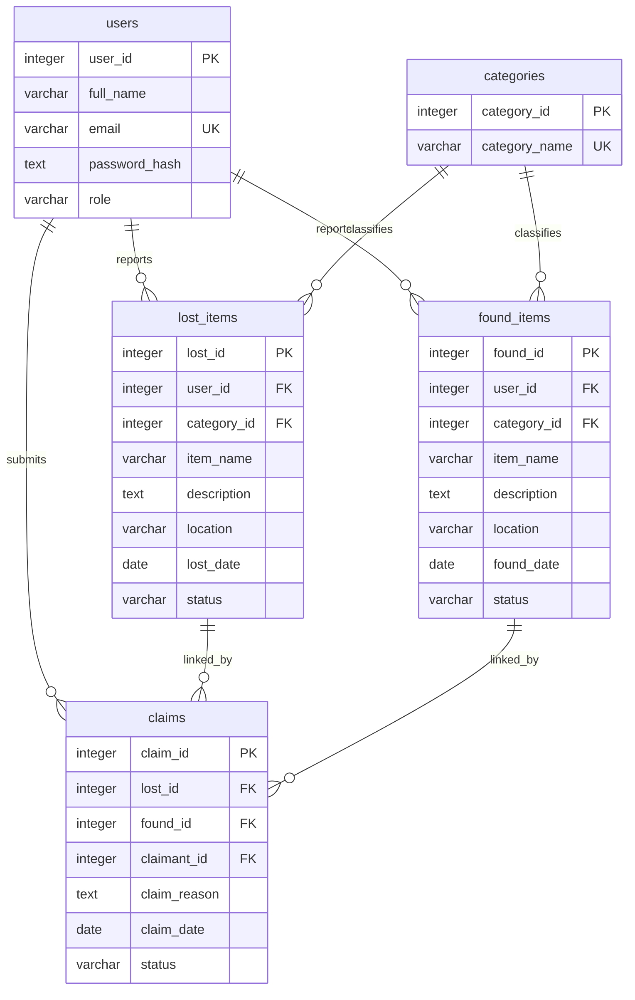

# FoundDesk database design — Phase 2

FoundDesk uses five PostgreSQL tables. A row represents one user, category,
lost report, found report or claim. The Flask application does not connect to
the database in this phase.

## Files and execution order

1. `database/schema.sql` creates the five tables and their constraints.
2. `database/sample_data.sql` inserts the six initial categories.

Each script uses `BEGIN` and `COMMIT` so its changes are applied together as a
transaction. Run the schema once in an empty database. It deliberately does not
drop existing tables or silently skip existing definitions. If a script fails
inside its transaction, run `ROLLBACK;` before correcting and retrying it.
The category script can be run again: `ON CONFLICT` skips names already present.
Identity sequences can have gaps, so IDs should not be treated as row counts.

## Entities and attributes

Every column is required (`NOT NULL`). A primary key also implies `NOT NULL`
and uniqueness. Every primary key is an `INTEGER GENERATED ALWAYS AS IDENTITY`:
PostgreSQL generates its value, so inserts normally omit it.

### users

Stores each registered person's account details once.

| Attribute | Type | Meaning and constraints |
| --- | --- | --- |
| user_id | INTEGER | Identity primary key identifying one user. |
| full_name | VARCHAR(100) | User's full name. |
| email | VARCHAR(254) | Unique email address. |
| password_hash | TEXT | Password hash generated by password-hashing code in a later phase. Never a plaintext password. |
| role | VARCHAR(10) | CHECK permits only `student` or `admin`; defaults to `student`. |

Email uniqueness uses PostgreSQL's ordinary text comparison. Later account code
should consistently trim and lowercase email addresses before storing and looking
them up. `NOT NULL` prevents missing values, but does not reject empty strings or
validate email format. Form validation belongs to later phases. Likewise, a TEXT
column cannot prove that its contents are a secure password hash; future account
code must generate that hash. No sample accounts are inserted in this phase.

### categories

Stores reusable classifications for lost and found reports.

| Attribute | Type | Meaning and constraints |
| --- | --- | --- |
| category_id | INTEGER | Identity primary key identifying one category. |
| category_name | VARCHAR(50) | Unique category name. |

Initial names are ID Cards, Keys, Electronics, Books, Accessories and Other.
Reports store the category ID rather than repeating its name.

### lost_items

Stores one lost-item report per row.

| Attribute | Type | Meaning and constraints |
| --- | --- | --- |
| lost_id | INTEGER | Identity primary key identifying one lost report. |
| user_id | INTEGER | Foreign key to `users.user_id`; person who reported the loss. |
| category_id | INTEGER | Foreign key to `categories.category_id`; report's classification. |
| item_name | VARCHAR(150) | Short name of the lost item. |
| description | TEXT | Details that help identify the item. |
| location | VARCHAR(200) | Place where the item was lost or last seen. |
| lost_date | DATE | Date of loss; explicitly supplied because it may be in the past. |
| status | VARCHAR(10) | CHECK permits `Lost` or `Resolved`; defaults to `Lost`. |

### found_items

Stores one found-item report per row. A found report may exist before anyone
reports the corresponding loss.

| Attribute | Type | Meaning and constraints |
| --- | --- | --- |
| found_id | INTEGER | Identity primary key identifying one found report. |
| user_id | INTEGER | Foreign key to `users.user_id`; person who reported finding the item. |
| category_id | INTEGER | Foreign key to `categories.category_id`; report's classification. |
| item_name | VARCHAR(150) | Short name of the found item. |
| description | TEXT | Details describing the found item. |
| location | VARCHAR(200) | Place where the item was found. |
| found_date | DATE | Date it was found; explicitly supplied. |
| status | VARCHAR(10) | CHECK permits `Available` or `Returned`; defaults to `Available`. |

### claims

Stores a person's request linking one lost report to one found report.

| Attribute | Type | Meaning and constraints |
| --- | --- | --- |
| claim_id | INTEGER | Identity primary key identifying one claim. |
| lost_id | INTEGER | Foreign key to `lost_items.lost_id`. |
| found_id | INTEGER | Foreign key to `found_items.found_id`. |
| claimant_id | INTEGER | Foreign key to `users.user_id`; person submitting the claim. |
| claim_reason | TEXT | Explanation supporting the claim. |
| claim_date | DATE | Submission date; defaults to `CURRENT_DATE`. |
| status | VARCHAR(10) | CHECK permits `Pending`, `Approved` or `Rejected`; defaults to `Pending`. |

`UNIQUE (lost_id, found_id)` prevents the same pair from being claimed twice,
even by a different user or after rejection. Each report may still appear in
claims involving different reports. The pair is also an alternate candidate key.
The schema records the claimant separately from the report's author; it does not
assume they must be the same person. Any ownership or approval workflow rules
must be defined and enforced in a later phase. Changing a claim's status does
not automatically change either report's status.

## Relationships and deletion rules

| Parent | Child foreign key | Relationship |
| --- | --- | --- |
| users.user_id | lost_items.user_id | One user can submit zero or many lost reports. |
| users.user_id | found_items.user_id | One user can submit zero or many found reports. |
| categories.category_id | lost_items.category_id | One category can classify zero or many lost reports. |
| categories.category_id | found_items.category_id | One category can classify zero or many found reports. |
| users.user_id | claims.claimant_id | One user can submit zero or many claims. |
| lost_items.lost_id | claims.lost_id | One lost report can have zero or many claims. |
| found_items.found_id | claims.found_id | One found report can have zero or many claims. |

Every child row refers to exactly one parent for each foreign key because those
keys cannot be NULL. Claims link lost and found reports in a many-to-many
relationship, with one row per distinct pair.

All foreign keys use `ON DELETE RESTRICT`. PostgreSQL refuses to delete a user,
category or report while another row refers to it. Deleting a report or user
therefore cannot silently delete associated claims. There is no cascading
deletion. Direct deletion of a claim remains possible with SQL; a permanent
audit log or permissions policy is outside this phase.

## ER diagram

Paste this Mermaid source into a Mermaid-compatible editor and export the diagram
as an image for the report. `||` means exactly one and `o{` means zero or many.



The diagram's individual FK markers do not show the composite uniqueness rule;
`claims` additionally has `UNIQUE (lost_id, found_id)`.

## Why separate tables? Normalization to 3NF

A single large table would repeat a user's name, email and password hash on every
report or claim. A category's name would also repeat. Updating one copy while
missing another would produce conflicting data (an update anomaly). We could not
easily add a category before a report existed (an insertion anomaly), and deleting
the last report could accidentally remove the only record of its user or category
(a deletion anomaly).

Separate tables avoid these problems:

- **1NF:** Each column stores one value, and each row has a primary key. There
  are no lists of claim IDs or repeated item columns inside one row.
- **2NF:** Non-key attributes depend on the whole candidate key. For claims,
  the reason, date, status and claimant describe the particular lost/found pair,
  rather than either report alone.
- **3NF:** Non-key attributes do not depend on other non-key attributes. User
  details stay in `users` and category names stay in `categories`; report rows
  contain only their IDs. Claim rows do not copy report details or user names.

Lost and found reports have similar columns but describe independent events with
different dates and status values. Keeping them separate follows this project's
five-table design. SQL JOINs can retrieve related names and details when needed;
the data does not need to be duplicated to display it together.

## Execute using pgAdmin

PostgreSQL must be installed and its server running; pgAdmin is the management
client, not the database server itself.

1. Open pgAdmin and connect to your PostgreSQL server using your local credentials.
2. Under that server, right-click **Databases**, choose **Create > Database**,
   enter `founddesk`, and save.
3. Select the new `founddesk` database and open **Tools > Query Tool**.
4. Use **Open File** to load `database/schema.sql` (or paste its contents).
   With no partial text selected, choose **Execute script** to run the whole file.
   Check the Messages panel for successful completion.
5. Open `database/sample_data.sql` in the same database and execute the whole
   script. The schema must be created first because the INSERT needs `categories`.
6. Refresh **Schemas > public > Tables**. You should see all five tables.
7. Run the verification queries below in a new Query Tool tab.

If the schema is already installed, do not rerun it or drop your data. Use the
verification queries instead. To retry an unsuccessful transaction, execute
`ROLLBACK;` first.

## Verify the database

```sql
-- Expect five FoundDesk tables in a new database.
SELECT table_name
FROM information_schema.tables
WHERE table_schema = 'public' AND table_type = 'BASE TABLE'
ORDER BY table_name;

-- Expect six category names; do not rely on specific generated IDs.
SELECT category_id, category_name
FROM categories
ORDER BY category_name;

-- Inspect identity generation, required columns and defaults.
SELECT table_name, column_name, is_nullable, is_identity,
       identity_generation, column_default
FROM information_schema.columns
WHERE table_schema = 'public'
ORDER BY table_name, ordinal_position;

-- Inspect named primary keys, foreign keys, UNIQUE and CHECK constraints.
SELECT conrelid::regclass AS table_name, conname AS constraint_name,
       pg_get_constraintdef(oid) AS definition
FROM pg_constraint
WHERE connamespace = 'public'::regnamespace
ORDER BY table_name, constraint_name;
```

Run the category script twice, then run `SELECT COUNT(*) FROM categories;`.
In a fresh database the result should still be `6`.

The intended constraint checks, when testing with temporary records, are:

| Attempt | Expected result |
| --- | --- |
| Insert a row without its generated ID | PostgreSQL supplies an ID. |
| Insert a missing required value as NULL | NOT NULL rejects it. |
| Repeat an email or category name | UNIQUE rejects it. |
| Use an unsupported role or status | CHECK rejects it. |
| Reference a user, category or report that does not exist | Foreign key rejects it. |
| Repeat a lost/found pair, regardless of claimant | Composite UNIQUE rejects it. |
| Delete a report referenced by a claim | RESTRICT rejects it; the claim stays. |

No test users or sample passwords are part of either SQL script.

## Optional command-line execution

If PostgreSQL's `psql` command is available, run these from the FoundDesk folder.
Replace `your_postgres_user` with your local PostgreSQL role. The database must
already exist. A password can be entered at the prompt; do not put it in a file
or command.

```sh
psql -h localhost -U your_postgres_user -d founddesk -v ON_ERROR_STOP=1 -f database/schema.sql
psql -h localhost -U your_postgres_user -d founddesk -v ON_ERROR_STOP=1 -f database/sample_data.sql
psql -h localhost -U your_postgres_user -d founddesk -c 'SELECT category_name FROM categories ORDER BY category_name;'
```

## Viva questions

1. **What is referential integrity?** Foreign keys ensure each referenced parent
   exists, for example the user who submitted a lost report.
2. **Why use a composite UNIQUE constraint on claims?** It rejects a repeated
   lost/found pair while allowing each report to appear with different reports.
3. **How does this design satisfy 3NF?** Each table stores facts about its own
   entity, and user or category details are referenced through keys rather than
   repeated in reports.

## References

- [PostgreSQL identity columns](https://www.postgresql.org/docs/17/ddl-identity-columns.html)
- [PostgreSQL constraints](https://www.postgresql.org/docs/17/ddl-constraints.html)
- [pgAdmin Query Tool](https://www.pgadmin.org/docs/pgadmin4/latest/query_tool.html)
- [pgAdmin Query Tool toolbar](https://www.pgadmin.org/docs/pgadmin4/latest/query_tool_toolbar.html)

## Suggested commit message

```text
feat: add normalized database schema and category seed data
```
