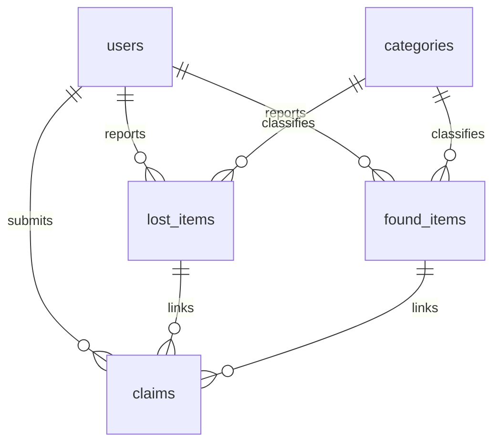

# FoundDesk — Lost and Found Item Tracking System

**Draft project report — Phase 11**

College: [TO BE FILLED]  
Department/course: [TO BE FILLED]  
Student name(s)/ID(s): [TO BE FILLED]  
Guide: [TO BE FILLED]  
Academic year: [TO BE FILLED]

This report describes the implemented code and schema through Phase 11. Successful
PostgreSQL workflows, SQL output and browser screenshots have not been verified.
Phase 12 must supply actual integration results before this becomes a final report.

## 1. Problem Statement

Lost belongings in a college may be reported through separate messages or verbal
announcements. This makes it difficult to browse reports, compare descriptions,
track ownership requests and record a return decision consistently. FoundDesk
provides one place to record lost and found reports and review claims linking them.

## 2. Objectives

- Store accounts, categories, lost reports, found reports and claims relationally.
- Let students submit and manage their own reports.
- Support simple item-name/category/location/type search.
- Link a student's unresolved loss to another student's available found report.
- Let admins verify claims and update related statuses together.
- Show meaningful SQL counts and lists, with clear access and validation rules.
- Demonstrate SQL, keys, joins, grouping, normalization and transactions in a form
  suitable for a college DBMS viva.

## 3. Application Description

FoundDesk is a local Flask web application with server-rendered HTML and basic CSS.
Registration creates student accounts; an intended admin is promoted separately
using trusted local SQL. Passwords are hashed. Authenticated users can browse lost
and found items; report editing/deletion is restricted to the report's owner.

A student can claim someone else's Available found report by selecting one of
their own Lost reports and explaining ownership. The claim starts Pending. The
admin sees Pending claims and can approve or reject. Approval marks the found item
Returned, the lost item Resolved and competing Pending claims for either item
Rejected in one transaction. Rejection alone changes only the claim status.

The UI uses white backgrounds, black text, links, forms and tables. It contains no
JavaScript framework, ORM, automatic matching service or external API.

## 4. Technology Stack

| Technology | Use in the implementation |
| --- | --- |
| Python 3 | Validation, route functions and application logic |
| Flask | Routing, requests, redirects, sessions, flash messages and templates |
| PostgreSQL | Intended local relational database at localhost:5432 |
| psycopg 3 | Parameterized SQL and connection/transaction management |
| python-dotenv | Load local .env settings |
| Werkzeug security | Password hashing and verification (available with Flask) |
| HTML/Jinja2 | Server-rendered forms, tables, inheritance and escaping |
| Basic CSS | Minimal spacing, borders and wrapping search controls |
| unittest | Non-DB automated checks; no SQLite or mock database |
| Git/VS Code | Source control and local editing |

Requirements are listed in requirements.txt without version pins. The local
interpreter/installed package versions should be recorded during final testing;
the report does not assume all Python/package combinations have been tested.

## 5. Functional Modules

| Module | Routes and behavior |
| --- | --- |
| Home | GET `/` shows total lost/found report counts or an availability message. |
| Accounts | GET/POST `/register` and `/login`; POST `/logout`. Student role is assigned by the server. |
| Lost reports | GET/POST `/report-lost` and `/lost-items/<lost_id>/edit`; POST `/lost-items/<lost_id>/delete`. |
| Found reports | GET/POST `/report-found` and `/found-items/<found_id>/edit`; POST `/found-items/<found_id>/delete`. |
| My Reports | GET `/my-reports` reads the session user's reports, with eligible edit/delete actions. |
| Browse/detail | GET `/browse-items` and `/items/<item_type>/<item_id>`; filter by item name/category/location/type and open details. |
| Claims | GET/POST `/found-items/<found_id>/claim`; student-only, owned unresolved loss and other-owned Available find. |
| My Claims | GET `/my-claims`; only the session claimant's claims and private reasons. |
| Admin decisions | GET `/admin`; POST `/admin/claims/<claim_id>/approve` or `/admin/claims/<claim_id>/reject`; admin-only. |
| Reports | GET `/reports`; admin-only totals, category/status counts and item lists. |

All routes except home/register/login and static assets require authentication.
Admin routes require the admin role as well. Reporting routes require login;
claim submission specifically requires student role. Routes receive IDs as integers;
ownership is determined by session predicates, never a submitted user_id.

Lost/found edit requires Lost/Available respectively. A report can be deleted only
by its owner and only when no claim references it, regardless of claim status.
Pending claims do not yet block editing of still-eligible report fields.

## 6. Entities and Attributes

All attributes are NOT NULL. IDs below are generated INTEGER identity primary keys.
See database/schema.sql for the executable definitions.

| Entity | Attributes with actual SQL types |
| --- | --- |
| users | user_id INTEGER; full_name VARCHAR(100); email VARCHAR(254); password_hash TEXT; role VARCHAR(10), default student |
| categories | category_id INTEGER; category_name VARCHAR(50) |
| lost_items | lost_id INTEGER; user_id INTEGER; category_id INTEGER; item_name VARCHAR(150); description TEXT; location VARCHAR(200); lost_date DATE; status VARCHAR(10), default Lost |
| found_items | found_id INTEGER; user_id INTEGER; category_id INTEGER; item_name VARCHAR(150); description TEXT; location VARCHAR(200); found_date DATE; status VARCHAR(10), default Available |
| claims | claim_id INTEGER; lost_id INTEGER; found_id INTEGER; claimant_id INTEGER; claim_reason TEXT; claim_date DATE, default CURRENT_DATE; status VARCHAR(10), default Pending |

Item dates describe the loss/discovery event, not entry creation time. There is
no return-date field, image attachment, item price or financial aggregate.

## 7. ER Diagram



Each report/claim has exactly one parent for each FK; a parent can have zero or
many child rows. Claims create a many-to-many link between loss and find reports,
with unique pairs. The full attribute-level Mermaid diagram is in database_design.md.

## 8. Relational Schema

```text
users(user_id PK, full_name, email UNIQUE, password_hash, role)
categories(category_id PK, category_name UNIQUE)
lost_items(lost_id PK, user_id FK -> users.user_id,
           category_id FK -> categories.category_id,
           item_name, description, location, lost_date, status)
found_items(found_id PK, user_id FK -> users.user_id,
            category_id FK -> categories.category_id,
            item_name, description, location, found_date, status)
claims(claim_id PK, lost_id FK -> lost_items.lost_id,
       found_id FK -> found_items.found_id, claimant_id FK -> users.user_id,
       claim_reason, claim_date, status, UNIQUE(lost_id, found_id))
```

## 9. Constraints and Validation

| Mechanism | Actual rule |
| --- | --- |
| PK/identity | Five generated INTEGER IDs; each identifies one row. Gaps are allowed. |
| UNIQUE | users.email, categories.category_name and claims(lost_id, found_id). |
| NOT NULL | Every column is required; this alone does not reject empty strings. |
| FK | Report owner/category and claim lost/found/claimant references must exist. All use ON DELETE RESTRICT. |
| users CHECK | role is student or admin. |
| lost CHECK | status is Lost or Resolved. |
| found CHECK | status is Available or Returned. |
| claims CHECK | status is Pending, Approved or Rejected. |
| Application validation | Trim required text; enforce name/location lengths, category membership, ISO dates not in future, basic email format and password length/confirmation. Claim reason is 1–2000 trimmed characters. |
| Application authorization | Owner predicates for edit/delete; student claim eligibility; claimant-only private list; admin-only review and reports. |

Foreign keys do not prove that the claimant owns the lost report or that a found
report is Available. The application checks these rules. There is no DB trigger
that automatically changes item status when a claim status changes by direct SQL.
Multiple Approved claims sharing an item are prevented through the route's locks
and checks, not an additional database unique index. Trusted direct SQL must not
bypass the workflow.

## 10. Normalization

**1NF:** Each column holds one value. There are no comma-separated claim lists or
repeated item columns in a row. Every table has a primary key.

**2NF:** Consider every candidate key, not only the generated ID. User/category/
report entity tables have single-column candidate keys. Claims also has the
alternate candidate key (lost_id, found_id); reason/date/status describe that pair.

**3NF:** User account facts are kept in users; category names in categories. Reports
refer to IDs rather than duplicating names/emails, avoiding update/insertion/deletion
anomalies. The four entity tables follow 3NF under the project dependencies.

**Claims limitation:** The current ownership rule means lost_id determines
claimant_id through lost_items.user_id. Keeping claimant_id in claims creates
a partial dependency on the composite alternate key and a transitive dependency
from claim_id. Claims is therefore not strictly in 2NF/3NF under the actual rule.
The specified schema is retained and agreement is enforced by submission/approval
checks. Removing the redundant column would require a future schema/query change.
The project should explain this limitation rather than claim perfect normalization.
See database_design.md for the fuller dependency discussion.

## 11. Important SQL Queries

These examples mirror application SQL. `%s` is a psycopg placeholder; Python passes
values separately. Use the literal teaching statements in database/queries.sql
when executing examples directly in pgAdmin.

```sql
-- Case-insensitive item-name search with readable category.
SELECT i.found_id AS item_id, i.item_name, c.category_name,
       i.location, i.found_date AS item_date, i.status, 'Found' AS item_type
FROM found_items AS i
JOIN categories AS c ON c.category_id = i.category_id
WHERE i.item_name ILIKE %s
ORDER BY i.found_date DESC, i.found_id DESC;

-- Private My Claims list: the parameter comes from session['user_id'].
SELECT c.claim_id, c.lost_id, c.found_id, c.claim_reason, c.claim_date, c.status,
       l.item_name AS lost_item_name, f.item_name AS found_item_name
FROM claims AS c
JOIN lost_items AS l ON l.lost_id = c.lost_id
JOIN found_items AS f ON f.found_id = c.found_id
WHERE c.claimant_id = %s ORDER BY c.claim_date DESC, c.claim_id DESC;

-- Insert a claim after eligibility/duplicate checks and row locks.
INSERT INTO claims (lost_id, found_id, claimant_id, claim_reason, claim_date, status)
VALUES (%s, %s, %s, %s, CURRENT_DATE, 'Pending');

-- Delete an owned lost report only if no claim references it.
DELETE FROM lost_items
WHERE lost_id = %s AND user_id = %s
  AND NOT EXISTS (SELECT 1 FROM claims WHERE claims.lost_id = lost_items.lost_id)
RETURNING lost_id;

-- GROUP BY/HAVING teaching query: categories with >= 2 unresolved losses.
SELECT c.category_name, COUNT(l.lost_id) AS unresolved_count
FROM categories AS c
INNER JOIN lost_items AS l ON l.category_id = c.category_id
WHERE l.status = 'Lost'
GROUP BY c.category_id, c.category_name
HAVING COUNT(l.lost_id) >= 2
ORDER BY unresolved_count DESC, c.category_name;
```

Totals use independent COUNT subqueries. Category counts GROUP BY category_id in
each item table first, then LEFT JOIN categories and COALESCE missing counts to
zero, avoiding multiplied counts. Claim status counts LEFT JOIN all three allowed
status names and COUNT(claim_id) to retain zeros. The demo script also illustrates
NOT EXISTS, a temporary CREATE VIEW and rolled-back INSERT/UPDATE/DELETE on a
temporary table; it never writes application tables. Full SQL explanations and
pgAdmin steps are in sql_reports.md.

### Claim approval transaction

1. Read the selected claim's found/lost/claimant IDs.
2. Lock the found row, then lost row with SELECT FOR UPDATE.
3. Lock claims sharing either item in claim ID order.
4. Recheck selected claim is Pending, reports are Available/Lost, ownership is
   eligible, and no related Approved claim already exists.
5. UPDATE selected claim to Approved, found to Returned, lost to Resolved, and
   other Pending claims sharing either item to Rejected.
6. Commit once after all writes. An exception/conflict rolls back. Flash success
   only after the connection context exits successfully.

Reject uses UPDATE with `WHERE claim_id = %s AND status = 'Pending' RETURNING claim_id`.
If no row is returned, a repeated/concurrent decision gives 409. Row locks are
intended to serialize competing approvals/submissions; actual race/rollback behavior
is NOT YET RUN against PostgreSQL.

## 12. Database Connectivity and Request Flow

db.py loads .env relative to its own file. DATABASE_URL points to the intended
local PostgreSQL database. get_connection() uses psycopg.connect with dict_row
and a five-second connection timeout. Each route opens connection/cursor context
managers. Normal completion commits; exceptions roll back; resources close.

SECRET_KEY signs Flask sessions. Blank/whitespace/the shipped placeholder are
rejected at startup. Generate a private random value; never commit .env. The app
stores only account/session/token information and flash messages in signed cookies,
not password hashes or private claim reasons. Signed does not mean encrypted.

Example search flow: the browser submits GET keyword/category/location/type;
Flask reads request.args and validates them; psycopg executes fixed query branches
with bound values; dictionary rows are passed to render_template; Jinja escapes
and displays the form/table. Lost/Found/All chooses one or two fixed SELECTs and
Python merges the results by event date. Keyword matches item_name only. `%` and
`_` retain ILIKE wildcard meaning.

Example claim flow: POST includes lost_id, reason and CSRF; before_request validates
the token; login/student guards run; Flask checks/locks related records; parameterized
INSERT creates Pending; successful commit redirects to My Claims (Post/Redirect/Get).
The claimant ID, date and initial status are chosen by the server, not the form.

## 13. Results and Observations — Draft Evidence

Static review found bound SQL parameters, ownership/role checks, CSRF forms, schema
status alignment and transaction contexts in the code. One necessary configuration
fix rejects the known example signing key and whitespace. The review also corrected
obsolete setup instructions and retained the honest normalization limitation.

On 2026-11-08, Python compilation, all 42 automated tests and loading all 14 Jinja
templates passed. Exact checks and scope are recorded in testing_checklist.md.
They cover non-DB behavior only: validation, access redirects/denials,
template escaping, startup configuration and deliberate missing-DATABASE_URL paths.
Test-created sessions and template input dictionaries do not prove real login,
persistence, successful SQL or browser layout.

| Integration evidence | Current status |
| --- | --- |
| PostgreSQL installation, schema and constraints | NOT YET RUN |
| Real registration/login and report CRUD | NOT YET RUN |
| Search SQL, claim submission and multi-account privacy | NOT YET RUN |
| Decisions, rollback and concurrent requests | NOT YET RUN |
| Aggregate totals, SQL demos and pgAdmin output | NOT YET RUN |
| Browser end-to-end checks and screenshots | NOT YET RUN |

No real DB outputs, timing claims, screenshots or successful end-to-end results
are included in this draft.

## 14. Screenshot Placeholders

Replace only after capturing the actual application in Phase 12. Use test accounts;
exclude .env, DB credentials, session cookies and unrelated personal details.

| Placeholder | Actual screen to capture after verification |
| --- | --- |
| [SCREENSHOT PENDING: S01] | Home with actual lost/found counts |
| [SCREENSHOT PENDING: S02] | Registration/login form (passwords hidden) |
| [SCREENSHOT PENDING: S03] | Lost report form and resulting My Reports row |
| [SCREENSHOT PENDING: S04] | Found report form and resulting My Reports row |
| [SCREENSHOT PENDING: S05] | Browse filters/results and item details |
| [SCREENSHOT PENDING: S06] | Claim form and claimant's Pending claim |
| [SCREENSHOT PENDING: S07] | Admin Pending Claims table with test data |
| [SCREENSHOT PENDING: S08] | Verified decision reflected in My Claims/item statuses |
| [SCREENSHOT PENDING: S09] | Reports totals/category/status tables |
| [SCREENSHOT PENDING: S10] | Real pgAdmin query output/constraints after execution |

## 15. Conclusion

FoundDesk's code implements a small relational lost-and-found workflow using
Flask, PostgreSQL SQL and server-rendered forms. It demonstrates relational keys,
joins, aggregates, constrained statuses and coordinated claim decisions. The
current draft documents what the code does and where it still needs evidence.
The project is not declared complete: Phase 12 must configure PostgreSQL, run the
full checklist, fix observed integration issues and supply real screenshots/results.

Known limits include session roles cached until login, application-enforced
cross-table rules, the claims normalization caveat, no stored return date, and
separate report SELECT snapshots during concurrent changes. No deployment, account
revocation, reset-password, upload or matching feature is claimed.
